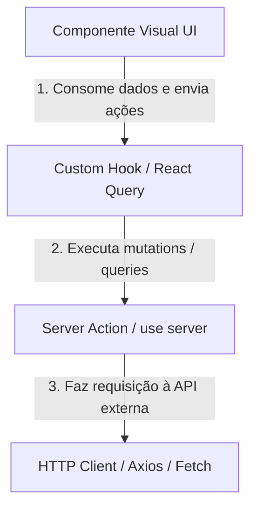

# Padrões de Desenvolvimento e Arquitetura de Features (Clean Architecture)

Este documento define as diretrizes arquiteturais e padrões de código para o desenvolvimento de novas features em projetos Next.js. O objetivo é manter o código profissional, altamente modular, extensível e com responsabilidades bem definidas, separando totalmente a lógica de negócio e estados de sincronização dos componentes visuais.

---

## 1. Estrutura de Diretórios de uma Feature

Cada feature deve ser auto-contida dentro de seu próprio diretório `src/features/<FeatureName>`. A estrutura interna deve seguir estritamente a divisão abaixo:

```text
src/features/<FeatureName>/
├── actions/             # Server Actions (Mutations & Data-fetching de servidor)
│   ├── get-<items>-action.ts
│   ├── get-<item>-action.ts
│   ├── post-<item>-action.ts
│   ├── put-<item>-action.ts
│   └── delete-<item>-action.ts
├── components/          # Componentes visuais de UI (Dumb e Smart components)
│      └── <FeatureName>/
│       ├── index.tsx    # Componente principal (Controller/Orchestrator da Feature)
│       └── <FeatureName>.test.tsx
├── enums/               # Enums TypeScript locais da feature
│   └── index.ts
├── hooks/               # Custom Hooks (Lógica de formulários, query strings e React Query)
│   ├── use-get-<items>.ts
│   ├── use-get-<item>.ts
│   ├── use-post-<item>.ts
│   ├── use-put-<item>.ts
│   └── use-delete-<item>.ts
├── http/                # Integrações brutas de API (Axios client)
│   ├── get-<items>.ts
│   ├── get-<item>.ts
│   ├── post-<item>.ts
│   ├── put-<item>.ts
│   └── delete-<item>.ts
├── schemas/             # Validações Zod (separados por arquivo/tipo de dados)
│   ├── get-<item>.ts
│   ├── post-<item>.ts
│   ├── put-<item>.ts
│   └── delete-<item>.ts
└── types/               # Tipos e Interfaces globais da feature (arquivo único, não um barrel de schemas/)
    └── index.ts
```

> **Sem barrel exports**: cada arquivo em `schemas/` deve ser importado diretamente pelo caminho completo (ex: `from "../schemas/brands-query-params"`), nunca através de um `index.ts` que reexporta o diretório inteiro. Barrels escondem de onde cada tipo realmente vem, dificultam a árvore de dependências e podem causar carregamento circular de módulos em testes. `types/index.ts` é uma exceção deliberada: não reexporta `schemas/`, é o único arquivo onde interfaces/tipos puros da feature são definidos diretamente.

---

## 2. Responsabilidade das Camadas e Fluxo de Dados

O fluxo de dados da feature segue uma hierarquia unidirecional e em camadas bem definidas:



### A. HTTP (`http/`)

Realiza as chamadas de rede cruas para os microsserviços.

- **Tecnologia**: Deve utilizar uma instância unificada do cliente de API (ex: Axios ou Fetch com interceptores configurados).
- **Regra**: Não deve conter gerenciamento de estado ou validações complexas. Apenas envia parâmetros e retorna a resposta mapeada.
- **Exemplo**:

  ```typescript
  import { api } from "@/src/config/api";
  import { ItemsListResponse, ItemsQueryParams } from "../schemas";

  export async function getItems(
    params?: ItemsQueryParams,
  ): Promise<ItemsListResponse> {
    const response = await api.get<ItemsListResponse>("/items", {
      params: {
        page: params?.page,
        size: params?.limit,
        search: params?.search,
      },
    });
    return response.data;
  }
  ```

### B. Server Actions (`actions/`)

Funções assíncronas rodando estritamente no servidor Next.js (`"use server"`).

- **Regra**: Servem de ponte segura. Tratam cookies de sessão, variáveis de ambiente seguras e manipulam autenticações sensíveis antes de chamar a camada HTTP.
- **Exemplo**:

  ```typescript
  "use server";

  import { getItems } from "../http/get-items";
  import { ItemsQueryParams } from "../schemas/items-query-params";

  export async function getItemsListingAction(params?: ItemsQueryParams) {
    try {
      const data = await getItems(params);
      return { success: true, message: "Sucesso", data };
    } catch (error: any) {
      console.error("[Get Items Action Error]", error);
      return { success: false, message: error.message || "Erro inesperado" };
    }
  }
  ```

### C. Custom Hooks & React Query (`hooks/`)

A camada de controle de estado e sincronização assíncrona.

- **Regra**: Todos os fetches de dados assíncronos e mutations devem ser encapsulados em hooks que utilizam `@tanstack/react-query` (`useQuery`, `useMutation`).
- **Sincronização de Filtros e URL (Debounce)**: Lógicas de filtros de busca com debounce que escrevem parâmetros na URL (`searchParams`) devem ser isoladas em um hook próprio de estado de filtros.
- **Exemplo de Hook de React Query (`use-item-management.ts`)**:

  ```typescript
  import { useQuery } from "@tanstack/react-query";
  import { getItemsListingAction } from "../actions/get-items-listing-action";
  import { ItemsQueryParams } from "../schemas/items-query-params";

  const ITEMS_QUERY_KEY = ["items"] as const;

  export function useItemManagement(params: ItemsQueryParams) {
    const { data, isLoading, isFetching, error, refetch } = useQuery({
      queryKey: [...ITEMS_QUERY_KEY, params],
      queryFn: async () => {
        const response = await getItemsListingAction(params);
        if (!response.success) {
          throw new Error(response.message);
        }
        return response.data;
      },
      placeholderData: (previousData) => previousData,
    });

    return {
      items: data?.data ?? [],
      total: data?.meta?.totalElements ?? 0,
      isLoading,
      isFetching,
      error,
      refetch,
    };
  }
  ```

- **Exemplo de Hook de Filtros e Query Strings (`use-item-filters-state.ts`)**:

  ```typescript
  import { useRouter, usePathname, useSearchParams } from "next/navigation";
  import { useForm, useWatch } from "react-hook-form";
  import { useEffect, useCallback } from "react";

  export function useItemFiltersState() {
    const router = useRouter();
    const pathname = usePathname();
    const searchParams = useSearchParams();

    const page = Number(searchParams.get("page") ?? "0");
    const pageSize = Number(searchParams.get("pageSize") ?? "10");
    const urlSearch = searchParams.get("search") ?? "";

    const { control, reset } = useForm({
      defaultValues: { search: urlSearch },
    });

    const watchedSearch = useWatch({ control, name: "search" });

    const updateParams = useCallback(
      (updates: Record<string, string | null>) => {
        const params = new URLSearchParams(searchParams.toString());
        Object.entries(updates).forEach(([key, value]) => {
          if (value === null || value === "") params.delete(key);
          else params.set(key, value);
        });
        router.replace(`${pathname}?${params.toString()}`);
      },
      [searchParams, pathname, router],
    );

    // Efeito com debounce de 1 segundo para atualização automática na URL
    useEffect(() => {
      const handler = setTimeout(() => {
        if (watchedSearch !== urlSearch) {
          updateParams({ search: watchedSearch, page: "0" });
        }
      }, 1000);
      return () => clearTimeout(handler);
    }, [watchedSearch, urlSearch, updateParams]);

    return {
      control,
      page,
      pageSize,
      urlSearch,
      updateParams,
      clearFilters: () => reset({ search: "" }),
    };
  }
  ```

### D. Componentes (`components/`)

A camada estritamente visual (apresentação).

- **Regra**: Devem apenas exibir informações e receber interações do usuário. Não instanciam estados do `react-hook-form` ou gerenciam chaves de query cache. Eles consomem as saídas dos hooks customizados.
- **Componente <FeatureName>/index.tsx (Controller)**: Atua como orchestrator. Consome os hooks de estado e React Query, decide sobre renderizações globais (como telas de loading ou tratamento global de erros) e distribui as propriedades para subcomponentes menores (`dumb components`).
- **Exemplo (`<FeatureName>/index.tsx`)**:

  ```typescript
  "use client";

  import { ProgressCircular } from "@/src/components/ProgressCircular";
  import { ErrorServer } from "@/src/components/ErrorServer";
  import { ItemFilters } from "./ItemFilters";
  import { ItemTable } from "./ItemTable";
  import { useItemFiltersState } from "../../hooks/use-item-filters-state";
  import { useItemManagement } from "../../hooks/use-item-management";

  export const ItemManagement = () => {
    const { control, page, pageSize, urlSearch, updateParams, clearFilters } = useItemFiltersState();
    const { items, total, isLoading, error, refetch } = useItemManagement({
      page: page + 1,
      limit: pageSize,
      search: urlSearch,
    });

    if (error) {
      return <ErrorServer error={error.message} refetch={refetch} />;
    }

    return (
      <>
        <ItemFilters control={control} onClear={clearFilters} />
        {isLoading ? (
          <ProgressCircular size={24} title="Carregando..." />
        ) : (
          <ItemTable
            items={items}
            total={total}
            page={page}
            pageSize={pageSize}
            onUpdateParams={updateParams}
          />
        )}
      </>
    );
  };
  ```

---

## 3. Reuso e utilitários globais de UI

- **Alertas e Notificações (Snackbar)**: Não repita múltiplos hooks de estado em cada componente para abrir, fechar ou definir severidade de toasts. Utilize o hook global de Snackbar:

  ```typescript
  import { useAlertSnackBar } from "@/src/hooks/use-alert-snackbar";

  const snackbar = useAlertSnackBar();
  // Uso direto: snackbar.showSuccess("Operação realizada!");
  // snackbar.showError("Erro inesperado!");
  ```

---

## 4. Padrões de Nomenclatura e Organização

- **Hooks**: prefixados com `use-`, separados por hífen e com nomes verbosos (ex: `use-<item>.ts`, `use-<item>-filters-state.ts`).
- **Actions**: sufixados com `-action.ts` (ex: `get-<items>-action.ts`, `post-<item>-action.ts`).
- **http**: apenas a ação correspondente (ex: `get-<items>.ts`, `post-<item>.ts`).
- **Componentes**: PascalCase para pastas e arquivos de componente (ex: `ItemFilters.tsx`).
- **Testes**: arquivos `.test.tsx` ou `.test.ts` localizados no mesmo diretório do arquivo de implementação correspondente para facilitar a busca e manutenção.

---

## 5. Guia Passo a Passo para Refatoração de Features Legadas

Ao encontrar uma feature legada com componentes gigantescos, lógicas misturadas e falta de padronização, siga este roteiro de refatoração passo a passo:

### Passo 1: Análise e Mapeamento

- Identifique no componente legado todas as chamadas `fetch` nativas, estados locais (`useState`), efeitos colaterais (`useEffect` observando filtros/URL) e schemas Zod.
- Mapeie quais ações representam apenas leitura (Queries) e quais representam escrita/alteração (Mutations).

### Passo 2: Extrair a Camada HTTP

- Mova as requisições brutas para a pasta `http/`.
- Crie um arquivo por endpoint/operação (ex: `delete-item.ts`, `get-items.ts`).
- Substitua `fetch` nativo por chamadas limpas da instância compartilhada do Axios (`api`).

### Passo 3: Decompor Schemas e Tipos

- Se a feature possuir tipos inline gigantescos ou um único arquivo de schemas sobrecarregado, separe em arquivos menores sob `schemas/` (ex: `item.ts`, `item-history.ts`).
- Não crie um `index.ts` (barrel) em `schemas/`. Cada consumidor (http, action, hook, componente) importa o arquivo de schema específico diretamente pelo caminho completo.
- Mova definições de tipos puramente TypeScript (não-Zod) para `types/index.ts`, incluindo as interfaces de resposta das Server Actions (`{ success, message?, data? }`).

### Passo 4: Implementar Server Actions

- Crie as Server Actions na pasta `actions/` decorando o topo do arquivo com `"use server"`.
- Chame as funções criadas na camada `http/` passando parâmetros limpos. Trate possíveis erros com blocos `try/catch` e retorne estruturas consistentes `{ success: boolean, message: string, data?: T }`.

### Passo 5: Construir Custom Hooks (Isolar Lógica de Negócio)

- Extraia toda a lógica de query strings, formulários de busca, debounce de campos de texto e paginação para um hook de estado de filtros (ex: `use-item-filters-state.ts`).
- Encapsule as queries e mutations do React Query em hooks dedicados (ex: `use-<items>.ts` ou `use-<item>.ts` usando `useQuery` e `useMutation`).
- Garanta que os hooks invalidem as queries corretas no cache ao concluir Mutations com sucesso.

### Passo 6: Simplificar e Modularizar Componentes Visuais

- Remova do componente principal todos os hooks do React, React Hook Form e React Query.
- No componente principal (ex: `index.tsx`), instancie apenas os hooks customizados criados no **Passo 5** e distribua as propriedades necessárias para os subcomponentes.
- Quebre o JSX gigante em subcomponentes menores e focados (ex: `<ItemFilters />`, `<ItemTable />`, `<ItemStatusToggle />`).

### Passo 7: Reorganizar e Ajustar Testes Unitários

- Mova os arquivos de testes unitários para ficarem adjacentes aos seus respectivos arquivos de componente ou hook (ex: `BrandFilters.test.tsx` dentro da pasta `components/BrandFilters/`).
- Atualize os mocks de importação (`vi.mock`) nas suítes de testes para apontarem diretamente para os arquivos individuais ao invés de barrel files para evitar carregamento de módulos circulares ou desnecessários.

---

## 6. Rigor Arquitetural e Critérios de Aceitação (Definição de Pronto)

Ao realizar qualquer refatoração ou implementar uma nova feature, seja extremamente rigoroso com as seguintes regras de validação. Qualquer desvio impede a feature de ser considerada concluída:

1. **Zero Lógica Acoplada nos Componentes**:
   - **Proibido**: Uso de `useState` para armazenar paginação (`page`, `pageSize`), filtros de pesquisa, debounces ou status de requisições diretamente na UI.
   - **Proibido**: Instanciação direta de `useForm` ou Zod schemas dentro dos componentes visuais.
   - **Critério**: O componente visual deve ser limpo e declarativo, delegando 100% da lógica e estado para os custom hooks.

2. **Tipagem Única e Centralizada**:
   - **Proibido**: Duplicar definições de tipos e interfaces em múltiplos arquivos (ex: tipos de resposta da API definidos no arquivo HTTP e repetidos nas Actions ou Views).
   - **Critério**: Defina os tipos de validação com Zod no diretório `schemas/` e as interfaces puras de TypeScript no arquivo `types/index.ts`. Qualquer componente ou action deve consumir exclusivamente estes pontos de verdade unificados.

3. **Arquivos Focados (Single Responsibility Principle)**:
   - **Proibido**: Acumular múltiplos endpoints HTTP em um único arquivo de requisições, ou múltiplos fluxos de ações em uma única Server Action.
   - **Critério**: Cada operação de rede ou mutação de dados deve possuir seu próprio arquivo dedicado (ex: `delete-item.ts`, `patch-item.ts`, `get-items.ts`).

4. **Tratamento de Erros e Estados Resilientes**:
   - **Proibido**: Deixar erros de requisição estourarem sem tratamento na interface, resultando em telas brancas ou loaders infinitos.
   - **Critério**: Toda Server Action e Hook de Query deve possuir tratamento com `try/catch` retornando fallbacks consistentes. Erros de autenticação expirada (401) ou indisponibilidade de servidor devem acionar redirecionamentos estruturados ou renderizar o componente `<ErrorServer />`.

5. **Testes Unitários Obrigatórios**:
   - **Proibido**: Entregar componentes, hooks ou utilitários sem testes automatizados que verifiquem o comportamento esperado e as ramificações de erro.
   - **Critério**: Todos os arquivos devem estar cobertos por testes unitários (`.test.tsx` / `.test.ts`) localizados ao lado de sua respectiva implementação, utilizando mocks limpos de dependências de rota e rede.
